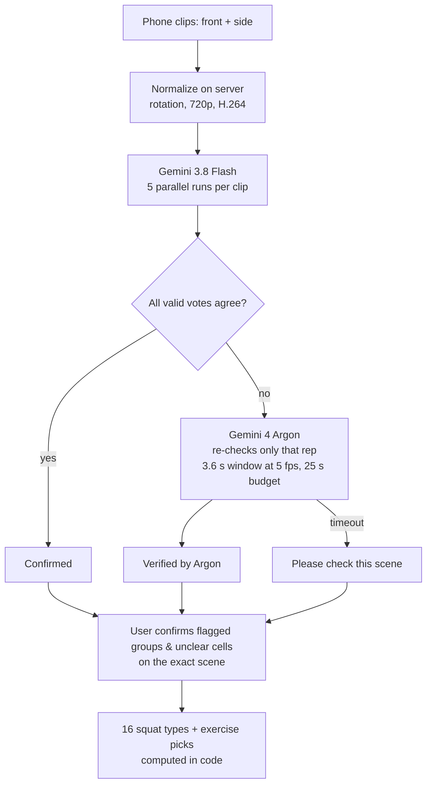

# SquatType

AI form feedback for people who train alone. Upload a front clip and a side clip of your squat; SquatType judges every rep, maps you to one of 16 squat types, and tells you what to practise next.

Track: Google AI for social good (health) · Live app: https://squattype-355633905976.asia-northeast3.run.app

## How it works



- **AI looks, code decides.** Models only report per-rep observations as JSON. Votes, types and recommendations are deterministic code (`logic.py`, unit-tested).
- **Self-consistency, not self-reported confidence.** The prompt asks for `low_confidence`, but we don't use it: in our tests the model reported high confidence on wrong answers. Agreement across the valid Flash runs (up to five, requiring at least three successful runs) is the uncertainty signal that triggers the Argon recheck.
- **Human in the loop.** Flagged problem axes are grouped by view and axis (plus any individual unclear cells), and each jumps inline to its representative scene and asks "Looks right / Not quite" before the type is final.
- **Session comparison.** Gemini 4 Argon reads last session and today's session in one request and cites the timestamps of what changed.

## Results on our test clips (`tests/eval.py`)

| Clips | Scored cells | False alarms | Missed | Still unclear | Predicted type |
| --- | --- | --- | --- | --- | --- |
| Planted faults (knees in, half depth, rounded back, bounce) | 19 / 19 correct | 0 | 0 | 1 | `SADB` — The Express Train (also reproduced on the deployed app) |
| Clean squats | 30 / 30 correct | 0 | 0 | 0 | `SADC` — The Textbook |
| Original "before" squats | not scored per rep | 0 | 0 | 2 | `RVDB` — The Roller Coaster |

The mixed clips plant each fault on a single rep, so per-rep scoring catches all of them (19 of 19) while the overall type stays SADB, because a type letter only changes when most reps share the problem.

A small test set from one person; treat the numbers as a sanity check, not a benchmark. Test clips show a real face and are not included in this repo.

## Design notes from pre-event experiments

- `fps=2` and `resolution="high"` on the full clip: fps 1 missed short bottom positions, fps 3–4 merged reps, default resolution failed depth.
- `thinking_level="low"` everywhere: medium/high were 2–4x slower with no accuracy gain.
- Raw iPhone clips (HEVC with rotation metadata) caught caving knees 1 time in 3; normalized clips 3 times in 3, hence server-side normalization.
- Prompts are written in Korean because they were validated in Korean; the app maps the model's Korean labels to language-neutral codes and shows everything in English.

## Safety

Form feedback, not medical advice. If the user reports pain, exercise picks are replaced by a suggestion to see a professional. Videos are analyzed in memory and never stored.

## Run locally

```bash
pip install -r requirements.txt
export GEMINI_API_KEY=...        # never commit it
streamlit run app.py
python -m pytest tests/test_logic.py
TEST_VIDEO_DIR=/path/to/clips python tests/eval.py   # needs the private test clips
```

## Deploy (Cloud Run)

```bash
gcloud run deploy squattype --source . --region asia-northeast3 --allow-unauthenticated \
  --memory 2Gi --cpu 2 --timeout 3600 --concurrency 4 --session-affinity --min-instances 1 --max-instances 3 \
  --set-secrets GEMINI_API_KEY=gemini-key:latest
```

Built with Gemini 4 Argon, Gemini 3.8 Flash, Google Antigravity and Cloud Run.
